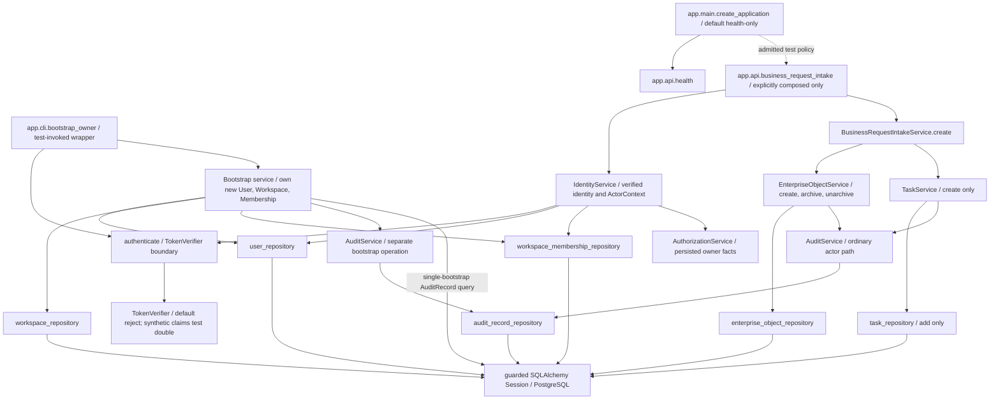

# C3 — current bounded synthetic backend components

Current code baseline: 4ed6667a750cebfee1504bf665278518d2164860.
This document describes implementation structure, not production exposure,
completion of entire WPs, full D07 compliance or non-authority certification.
A-13 is NOT APPROVED; its erroneous approval was corrected with external audit
trail. A-12 remains historical WP13 authority without retroactive expansion.
Later MVP records and scoped implementation grants are independent authority.
Publication authority is the separately recorded Owner adoption of exact A-14
bytes; this component view grants no code/runtime/provider/CI/compose operations.

## Component path

## Layer/authority matrix

| Component | Implemented surface | Boundary |
|---|---|---|
| User/Workspace/Membership | Models, scoped persistence, identity/bootstrap | Synthetic verifier only; no real signature/provider |
| EnterpriseObject | create/archive/unarchive, scoped repository | A-12 historical; actor/policy integration separately recorded |
| Task | create, repository add | No archive/unarchive/get/list/read endpoint; non-null source creation rejected |
| Business request | EO+Task create, Task ID response | One endpoint transaction under ADR-0017; no persisted EO-Task link |
| Audit | ActorContext ordinary record and separate bootstrap record set | Bootstrap actions rejected by ordinary path; caller transaction |
| AgentDefinition | Existing schema foundation | No new runtime/configuration authority |
| RuntimeEvent | Not emitted by this bounded slice | Retained obligations and explicit hard-expiry deferrals |

Default application omits intake (404). In explicitly admitted test composition,
missing/invalid token is 401; authenticated denial is uniform 404. The endpoint
owns begin/commit/rollback only; intake delegates to guarded primitives. Audit
and mutation share the caller Session/transaction, actor context resolved from
persisted authorization facts. G01 is not globally closed by this bounded design.
Bootstrap directly queries AuditRecord through the guarded Session for the
single-bootstrap check. It creates its own new subjects and three linked audit records, one
bootstrap only; no ordinary-audit spoofing and no retrospective authority.

## Boundaries and unresolved gates

The import checker permits business_request_intake_service to call both bounded
services and permits each protected repository only from its own service.
Computed reflection/arbitrary Session/raw SQL remain outside static coverage.
ExecutionPolicy guards named paths, actual bind/role/libpq; profile is not an
authority/provenance/non-authority label. Migration preflight is guarded too.
CI inventory and exactly one local-only lock file form a recursive partition.
Every exact-head formal local gate and applicable exact-head CI remain required.
The latest positive lock evidence is prior-byte WORKTREE_VALIDATION, not a gate
for current HEAD. No completed CI/compose/production gate claimed here.
History UNKNOWNs, runtime/event/idempotency/version/history deferrals and expiry
before first real user/authoritative use remain. See ADR-0016, ADR-0017 and plan A-14.

## Historical correction trail

Prior working C3 bytes and full SHA-256 are preserved in this publication
package's baseline copy and the original A-13 attribution correction at
workflow_BIZZI/2026-10_wp15/a13_attribution_correction_2026-10-04/.
This replaces stale current diagrams, not the historical correction or A-12.

## Decision references

- External adopted source `workflow_BIZZI/2026-10_adw02/mvp_decision_package_2026-10-04_revision_2/ADW02_MINIMUM_DECISIONS.md`, SHA-256 `d269d192e0793b5b44c94d71ac61ddb9e6e4b9388a47ff2399de0e11d59dd204`.
- External adopted source `workflow_BIZZI/2026-10_adw02/mvp_decision_package_2026-10-04_revision_2/MVP_BOUNDARY_DECISION_WP13_WP15.md`, SHA-256 `99f3bbb4b51207eecc50f076df080ad494c5a8e49910f317322dcb11a57e5fd7`.
- External adopted source `workflow_BIZZI/2026-10_adw02/RC_DRAFT_RECORD_4B_BOOTSTRAP_AUDIT_ACTIONS_2026-10-04_rev3.md`, SHA-256 `b268398011f4e7752b683406bf7996fc0d70a0d1c15a97dbafc2d335cfe84378`.
- External adopted source `workflow_BIZZI/2026-10_adw02/RC_DRAFT_RECORD_4C_SINGLE_BOOTSTRAP_2026-10-04.md`, SHA-256 `3e1396b1e95ff1c83416bb257c0c0eca5c9d425cd5ff4e81cf048446d6697948`.
- External adopted source `workflow_BIZZI/2026-10_adw02/CODEX_DRAFT_RECORD_5_AMENDMENT_4_C1_C2_B5_2026-10-06_rev2.md`, SHA-256 `1b015fa8f805d4c6c914c004f54f2ac601a07fb71a12b45888e1ea4a1b9d7b71`.
- External adopted source `workflow_BIZZI/2026-10_adw02/CODEX_DRAFT_WP23_CONTRACT_SELECTION_2026-10-05_rev2.md`, SHA-256 `30d5f61087d9f6aa54546fbf3dd78d870d7d82940273bf6c59999f1073441f83`.
- External adopted source `workflow_BIZZI/2026-10_adw02/CODEX_DRAFT_WP23_DISABLED_ROUTE_AMENDMENT_2026-10-06_rev2.md`, SHA-256 `14af366e5059b8c4ecc60852bf5930dc325c50924d763cc02ecde21c4520fce0`.
- External adopted source `workflow_BIZZI/2026-10_adw02/RC_DRAFT_OWNER_ARCHITECTURE_DECISIONS_F1_AND_P4_2026-10-07.md`, SHA-256 `9e20ac1b3e418dfb09a8e4685acfba6f4ea2748f9d8e013c2062349c0ad61011`.
- External adopted source `workflow_BIZZI/2026-10_adw02/RC_DRAFT_OWNER_DECISION_BACKEND_CI_APPROVAL_AND_DECISION_2026-10-07.md`, SHA-256 `99d9efcdbd6644035cec2c13d16cb782648a4a114077f851b448cafbc2cb44a2`.
- External adopted source `workflow_BIZZI/2026-10_adw02/CODEX_DRAFT_OWNER_RECORD_L_OPTION_L_ARCHITECTURE_DECISION_2026-10-07_rev2.md`, SHA-256 `0123ced0601f832838cc0d0ccc4ab0c9a13c1bccdea30091d8b1e18b76d149b3`.

Current import-matrix authority: external adopted record-5 amendment 3 source
`workflow_BIZZI/2026-10_adw02/CODEX_DRAFT_RECORD_5_AMENDMENT_3_WP23_IMPORT_MATRIX_2026-10-05_rev2.md`,
SHA-256 `0e04a7ac047aca46f88084520b947daffb47c2b26ea7838827d962524ac6ec29`. This source, not A-13, admits the intake consumer.
